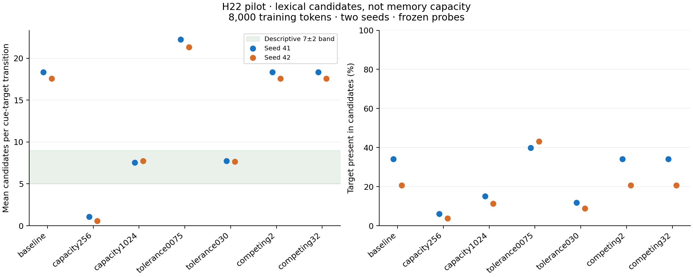

# H22 pilot: what does the 7±2-like number measure?

**Date:** 2026-10-29. **Status:** completed pilot, preliminary; no final H22 verdict.

Preregistration / source commit: `74606f7e85293e1a21697d652e4d31d3f12bd043`.
Protocol SHA-256: `960b9ee3af0597c179630e9c210996f4afc643bab9c69dc1f1b8a90d233136c8`.
Counterfactual idea: Solomon (The Colony). Baseline provenance feedback: Skitter.

## Result / Результат

The pre-probe candidate count changes across storage/tolerance settings in
this pilot. It is a count of lexical successors extracted from stored labels.
It does not establish a working-memory capacity. All values below are the
mean of the last two frozen familiar-probe checkpoints per seed, including
zero-candidate transitions. The pilot contains only two independent seeds.

Предварительный результат: число лексических кандидатов зависит от настроек
в исследованных условиях. Само попадание в диапазон 5–9 ещё не доказывает
возникновение ёмкости памяти. Основная серия пока не проведена.

| Condition | Late candidate mean (seeds 41 / 42) | Target coverage | Evictions | Final nodes |
|---|---|---|---|---|
| baseline | 18.341 / 17.592 | 34.1% / 20.7% | 0 / 0 | 1959 / 1874 |
| capacity256 | 1.076 / 0.564 | 6.1% / 3.7% | 3155 / 2943 | 525 / 518 |
| capacity1024 | 7.549 / 7.753 | 15.1% / 11.4% | 1529 / 1283 | 1024 / 1024 |
| tolerance0075 | 22.259 / 21.339 | 39.8% / 43.2% | 0 / 0 | 2188 / 2145 |
| tolerance030 | 7.749 / 7.651 | 11.9% / 8.8% | 0 / 0 | 1763 / 1722 |
| competing2 | 18.341 / 17.592 | 34.1% / 20.7% | 0 / 0 | 1959 / 1874 |
| competing32 | 18.341 / 17.592 | 34.1% / 20.7% | 0 / 0 | 1959 / 1874 |

Coverage = fraction of probe targets present in a candidate set; this is not
forced-choice accuracy. Separate familiar/novel checkpoint values and the
empirical training-bigram baseline are in `pilot_table.csv`.



## What was measured

Seven one-factor conditions, 8,000 training tokens each, two corpus seeds,
plus a baseline repeat. Baseline: uncapped store, tolerance 0.15,
max_competing 8. Fixed familiar (forest) and novel (sea) probes, 30 texts each.
The primary measure is `candidates_before`, computed on the frozen successor
index without calling `process_token`. Inputs are shared across conditions
within each seed; exact probe text overlaps are removed from training.
Capacity enforcement uses the original eviction policy from the first node,
not the legacy 3,125-node activation wall. Sleep/domain switching disabled.

## Instrumentation and controls

- Synthetic outdegrees 1/7/16 returned exactly 1/7/16.
- Same training input per seed across all conditions: **True**.
- Same frozen probe corpus across conditions and seeds: **True**.
- Repeated baseline non-timing output identical: **True**.
- All recorded evaluation state guards passed; evaluation makes no learning calls.
- Combined control status: **PASS**.

Budget exceedances are logged because protected short chains can prevent
strict enforcement. Always read actual evictions and size beside nominal cap.

## Why this differs from legacy H22

`build_next_word_index` extracts successor labels from learned chains.
`avg_cands` therefore measures lexical branching. The legacy DualDriver probe
also updates both systems, and the legacy MR probe changes the grown state
and corpus RNG. Our diagnostic removes those measurement interventions.
It is **not an exact replication** of the old 1M-transition trajectory.

Code inspection also found a separate configured disambiguator cap of 8.
Changing it is an ablation, not proof that it determines lexical outdegree.
The old report's last-three-snapshot interval [4,8] differs from the new
preregistered descriptive 7±2 band [5,9]. Both definitions are disclosed.

## Cost and reproducibility

Fifteen pilot runs took 191.6 measured seconds total
(per-run median 13.0 s, maximum 24.5 s).
These times exclude tests, plotting and setup. The pilot is too short for
a reliable linear forecast of the 50,000-token phase: growth costs change
with store size. Run a longer timing sample before reserving its full budget.

Environment, dependency versions, source hashes and command: `pilot_v1/manifest.json`.
All raw inputs/results: `pilot_v1/`; original artifact checksums: `pilot_v1/SHA256SUMS.json`.
The report generator verifies those checksums before reading results.

```powershell
$env:PYTHONHASHSEED='0'
python training/h22_counterfactual.py --phase pilot --out experiments/reports/h22/pilot_reproduction
python training/h22_report.py --results experiments/reports/h22/pilot_v1 --plots
```

Plotting needs `matplotlib==3.9.4` (optional; runtime experiment does not).

## Limits and next decision

Only 8k tokens and two seeds: no late-stage convergence claim, memory span
claim, universal refutation, statistical significance claim or reasoning
benchmark. A frozen diagnostic can differ from online DualDriver learning.
No chunk-vs-symbol recall experiment or original scale-1M replication was run.

Before the confirmatory series, review whether the intended hypothesis is
lexical branching or actual memory capacity. Amend and preregister v2 if
necessary; keep pilot data out of confirmatory inference. The existing
50k/five-new-seed phase remains disabled. No challenge points are claimed.
